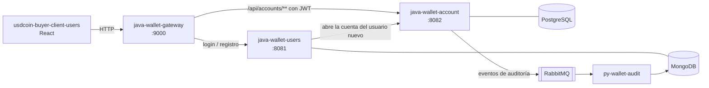

# java-wallet-gateway

[](https://github.com/josejps84/java-wallet-gateway/actions/workflows/ci.yml)

**API gateway** de la billetera: es el único punto de entrada del front end. Enruta cada petición al microservicio que corresponde, rechaza sin token las rutas protegidas antes de que lleguen a los servicios, y centraliza CORS.



| Repo | Rol |
|---|---|
| **java-wallet-gateway** | Punto de entrada único (este repo) |
| [java-wallet-users](https://github.com/josejps84/java-wallet-users) | Registro, login y emisión de JWT |
| [java-wallet-account](https://github.com/josejps84/java-wallet-account) | Cuentas y movimientos |
| [py-wallet-audit](https://github.com/josejps84/py-wallet-audit) | Guarda los eventos de auditoría |
| [usdcoin-buyer-client-users](https://github.com/josejps84/usdcoin-buyer-client-users) | Interfaz web |

## Stack

Java 25 · Spring Boot 4.1 · Spring Cloud Gateway Server Web MVC · JJWT · JUnit 5.

## Rutas

| Entrada | Destino | Autenticación |
|---|---|---|
| `POST /api/users/login` | users (`AUTH_URL`) | pública |
| `POST /api/users/register` | users (`AUTH_URL`) | pública |
| `/api/accounts/**` (cualquier método) | account (`ACCOUNT_URL`) | **JWT obligatorio** |
| cualquier otra | — | 404 (no se enruta) |

El resto de `/api/users` no se expone: el servicio de usuarios solo es accesible desde fuera para login y registro.

## Cómo funciona la autenticación

1. **Emisión:** `java-wallet-users` firma el JWT con HMAC-SHA usando el secreto compartido `JWT_SECRET`.
2. **Validación en el gateway:** `AuthenticationFilter` valida la firma y la expiración en cada ruta de cuentas. Si falta el header `Authorization: Bearer ...` o el token no es válido, responde **401** con un `ProblemDetail`, sin llamar al servicio:
   ```json
   { "status": 401, "title": "Unauthorized", "detail": "Token inválido o expirado" }
   ```
3. **Reenvío:** si el token es válido, se reenvía la petición intacta, incluidos el header `Authorization`, el path y el query string.
4. **Autorización:** las reglas finas, como quién es dueño de qué cuenta y qué puede hacer un admin, las aplica `java-wallet-account`, que vuelve a validar el token. Así el servicio queda protegido aunque alguien lo llame sin pasar por el gateway.

## CORS

Los orígenes permitidos se configuran con `CORS_ALLOWED_ORIGIN_PATTERNS`. Por defecto son `http://localhost:*` y `http://127.0.0.1:*`.
- Los preflight (`OPTIONS`) se responden en el gateway, sin llegar a los servicios.
- Se permiten los métodos `GET`, `POST`, `PUT`, `DELETE` y `OPTIONS`, y los headers `Authorization` y `Content-Type`.
- Las cabeceras CORS duplicadas que devuelvan los servicios se eliminan con `DedupeResponseHeader`.

## Configuración

Por variables de entorno. Para correrlo en local se pueden poner en un archivo `.env` en la raíz del repo (está en `.gitignore`; ver [`.env.example`](.env.example)).

| Variable | Obligatoria | Default | Descripción |
|---|---|---|---|
| `JWT_SECRET` | sí | — | El mismo secreto que usan users y account (mínimo 32 bytes) |
| `AUTH_URL` | no | `http://localhost:8081` | URL del servicio de usuarios |
| `ACCOUNT_URL` | no | `http://localhost:8082` | URL del servicio de cuentas |
| `CORS_ALLOWED_ORIGIN_PATTERNS` | no | `http://localhost:*,http://127.0.0.1:*` | Orígenes permitidos, separados por coma |
| `SERVER_PORT` | no | `9000` | Puerto HTTP |

## Ejecutar en local

Requisitos: **JDK 25** (Lombok todavía no soporta versiones más nuevas).

```sh
cp .env.example .env   # completar JWT_SECRET
./mvnw spring-boot:run
```

Para que las rutas respondan, users y account tienen que estar corriendo en las URLs configuradas.

### Docker

```sh
docker build -t wallet-gateway .
docker run -p 9000:9000 -e JWT_SECRET=... -e AUTH_URL=http://<users>:8081 -e ACCOUNT_URL=http://<account>:8082 wallet-gateway
```

## Tests

```sh
./mvnw test
```

- **`AuthenticationFilterTest`:** token ausente, falsificado o expirado se rechaza; un token válido pasa.
- **`GatewayRoutingTest`:** levanta el gateway real delante de un servidor HTTP simulado y comprueba:
  - Que login y registro son públicos.
  - Que el resto de `/api/users` no se enruta.
  - Que `/api/accounts` sin token o con un token falso da 401 sin llegar al servicio.
  - Que el token, el path y el query se reenvían.
  - Que los errores del servicio pasan tal cual.
  - Que CORS solo acepta los orígenes permitidos.

El [workflow de CI](.github/workflows/ci.yml) corre `./mvnw verify` en cada push a `main` y en cada pull request.
